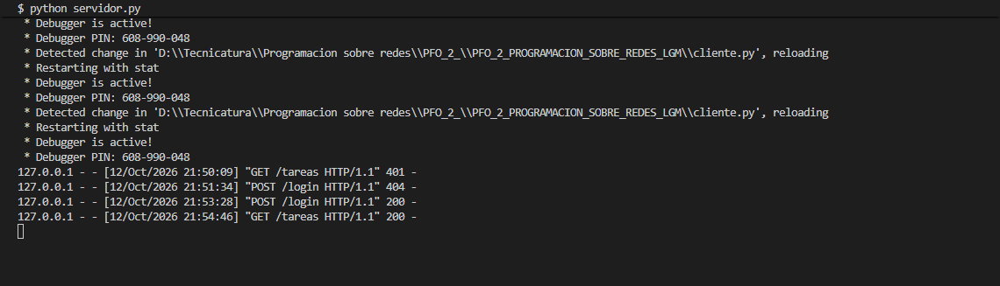
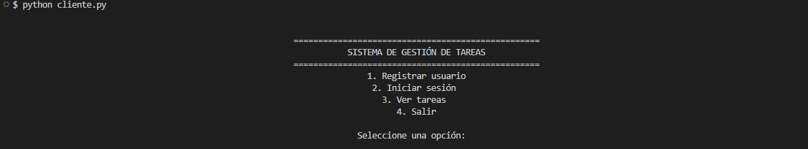
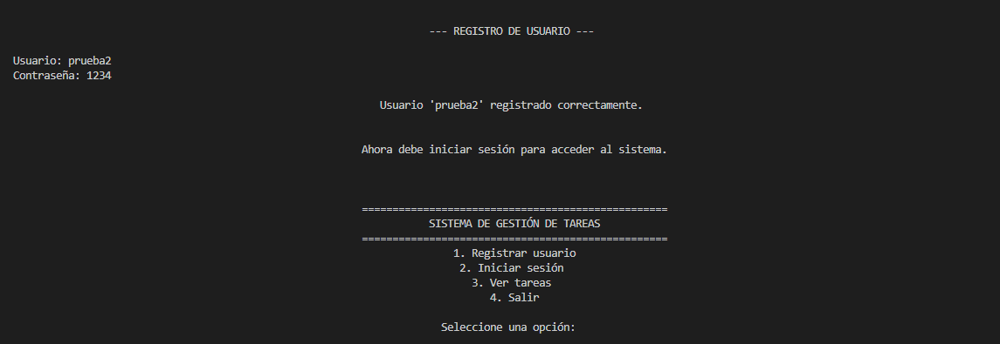
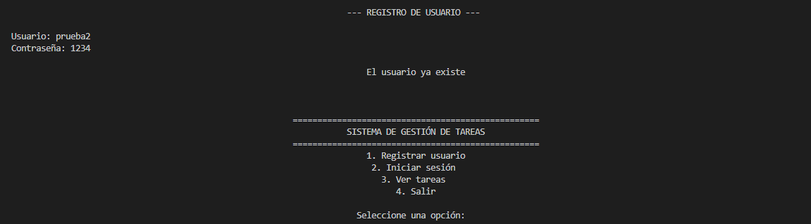
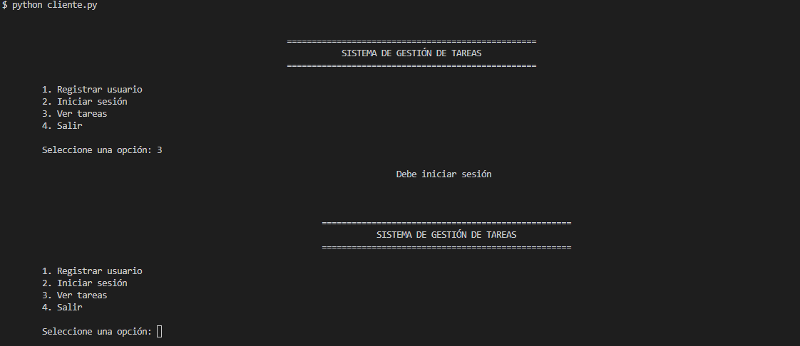
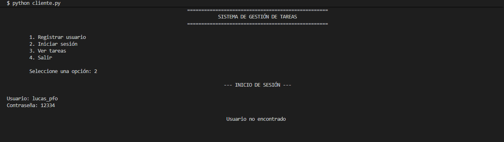
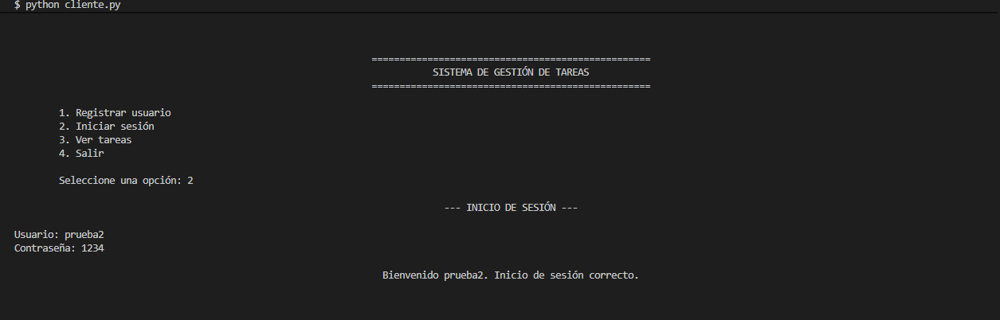
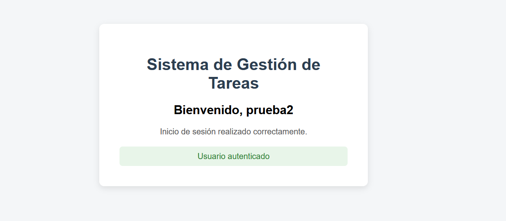
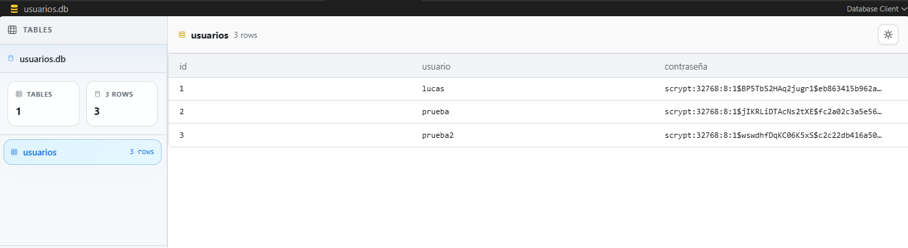

# PFO 2 - Sistema de Gestión de Tareas con API REST

## Tecnicatura Superior en Desarrollo de Software

**Institución:** IFTS N.º 29  
**Carrera:** Tecnicatura Superior en Desarrollo de Software  
**Materia:** Programación sobre Redes  
**Trabajo:** Práctica Formativa Obligatoria N.º 2  
**Año:** 2026  
**Alumno:** Lucas Monteras  

---

## Descripción del proyecto

Este repositorio contiene el desarrollo de la Práctica Formativa Obligatoria N.º 2 de la materia **Programación sobre Redes**.

El objetivo del trabajo es implementar un sistema cliente-servidor utilizando una API REST desarrollada con Flask, persistencia de datos mediante SQLite y autenticación de usuarios con protección de contraseñas.

El sistema permite:

- Registrar usuarios.
- Almacenar contraseñas de forma segura mediante hashing.
- Iniciar sesión validando las credenciales.
- Mantener una sesión autenticada.
- Restringir el acceso a usuarios no autenticados.
- Acceder al endpoint `/tareas`.
- Mostrar una vista HTML de bienvenida.
- Interactuar con la API mediante un cliente de consola desarrollado en Python.

---

## Tecnologías utilizadas

- Python
- Flask
- SQLite
- Requests
- Werkzeug
- HTML
- Git
- GitHub

---

## Arquitectura del sistema

El proyecto utiliza una arquitectura cliente-servidor.

```text
┌─────────────────────┐
│  Cliente de consola │
│     cliente.py      │
└──────────┬──────────┘
           │
           │ HTTP
           ▼
┌─────────────────────┐
│      API Flask      │
│    servidor.py      │
└──────────┬──────────┘
           │
           │ SQL
           ▼
┌─────────────────────┐
│       SQLite        │
│     usuarios.db     │
└─────────────────────┘
```

El cliente envía solicitudes HTTP a la API Flask.

El servidor procesa las solicitudes, valida las credenciales y utiliza SQLite para almacenar la información de los usuarios.

---

## Flujo del sistema

```text
Inicio
  │
  ▼
Ejecutar servidor Flask
  │
  ▼
Ejecutar cliente de consola
  │
  ▼
Registrar usuario
  │
  ▼
Hashear contraseña
  │
  ▼
Guardar usuario en SQLite
  │
  ▼
Iniciar sesión
  │
  ▼
Verificar usuario y contraseña
  │
  ▼
Crear sesión
  │
  ▼
Solicitar GET /tareas
  │
  ▼
Mostrar HTML de bienvenida
```

---

## Estructura del proyecto

```text
PFO_2_PROGRAMACION_SOBRE_REDES_LGM/
│
├── img/
│   ├── 01_servidor_ejecutando.png
│   ├── 02_menu_cliente.png
│   ├── 03_registro_exitoso.png
│   ├── 04_usuario_duplicado.png
│   ├── 05_acceso_sin_login.png
│   ├── 06_login_incorrecto.png
│   ├── 07_login_exitoso.png
│   ├── 08_tareas_html.png
│   └── 09_base_datos_hash.png
│
├── cliente.py
├── servidor.py
├── requerimientos.txt
├── .gitignore
└── README.md
```

El archivo `usuarios.db` se genera automáticamente al ejecutar el servidor.

---

## Instalación y ejecución

### 1. Clonar el repositorio

```bash
git clone https://github.com/LucasMonteras/PFO_2_PROGRAMACION_SOBRE_REDES_LGM.git
```

Ingresar a la carpeta:

```bash
cd PFO_2_PROGRAMACION_SOBRE_REDES_LGM
```

### 2. Crear un entorno virtual

```bash
python -m venv .venv
```

En Git Bash:

```bash
source .venv/Scripts/activate
```

### 3. Instalar las dependencias

```bash
pip install -r requerimientos.txt
```

### 4. Ejecutar el servidor

```bash
python servidor.py
```

La API queda disponible en:

```text
http://127.0.0.1:5000
```

### 5. Ejecutar el cliente

Abrir una segunda terminal y ejecutar:

```bash
python cliente.py
```

El cliente mostrará el menú principal:

```text
==================================================
           SISTEMA DE GESTIÓN DE TAREAS
==================================================

1. Registrar usuario
2. Iniciar sesión
3. Ver tareas
4. Salir
```

---

## Endpoints desarrollados

### POST /registro

Permite registrar un nuevo usuario.

Ejemplo:

```json
{
  "usuario": "lucas",
  "contraseña": "1234"
}
```

Antes de almacenar la contraseña, el servidor genera un hash mediante Werkzeug.

De esta manera, la contraseña original no queda almacenada en texto plano.

### POST /login

Verifica las credenciales enviadas por el usuario.

Si el usuario existe y la contraseña es correcta, se crea una sesión que permite acceder al endpoint protegido `/tareas`.

### GET /tareas

Es un endpoint protegido.

Solamente puede acceder un usuario que haya iniciado sesión correctamente.

Si la sesión es válida, el servidor devuelve una página HTML de bienvenida.

---

## Pruebas de funcionamiento

Las siguientes capturas muestran el flujo completo del sistema, desde la ejecución del servidor hasta el acceso al endpoint protegido.

### 1. Servidor Flask en ejecución

Primero se inicia el servidor Flask.

```bash
python servidor.py
```

La API queda escuchando solicitudes en el puerto 5000.



---

### 2. Cliente de consola

En una segunda terminal se ejecuta el cliente:

```bash
python cliente.py
```

Desde este menú se puede registrar un usuario, iniciar sesión y acceder al endpoint de tareas.



---

### 3. Registro exitoso

El usuario selecciona la opción de registro e ingresa su nombre de usuario y contraseña.

El cliente envía los datos mediante una solicitud:

```text
POST /registro
```

Si el registro se realiza correctamente, el servidor guarda el usuario en SQLite y devuelve una respuesta exitosa.



---

### 4. Control de usuario duplicado

Si se intenta registrar nuevamente un usuario que ya existe, el servidor rechaza la operación.

Esto evita que existan usuarios duplicados en la base de datos.



---

### 5. Acceso sin iniciar sesión

El endpoint `/tareas` está protegido.

Si el usuario intenta acceder sin haber iniciado sesión previamente, el sistema informa que debe autenticarse.



---

### 6. Inicio de sesión con contraseña incorrecta

El usuario intenta iniciar sesión con una contraseña incorrecta.

El servidor compara la contraseña ingresada con el hash almacenado y rechaza el acceso si no coincide.



---

### 7. Inicio de sesión correcto

Cuando el usuario y la contraseña son correctos, el servidor valida las credenciales y crea una sesión autenticada.

A partir de ese momento el usuario puede acceder al endpoint `/tareas`.



---

### 8. Acceso al endpoint /tareas

Una vez iniciada la sesión, el cliente realiza una solicitud:

```text
GET /tareas
```

El servidor verifica la sesión y devuelve una página HTML de bienvenida.



---

### 9. Persistencia y hashing de contraseñas

Los usuarios registrados quedan almacenados en SQLite.

La contraseña original no se guarda en texto plano. En la base de datos se almacena el hash generado por Werkzeug.



---

## Flujo completo de autenticación

```text
Usuario
   │
   ▼
Cliente de consola
   │
   │ POST /registro
   ▼
API Flask
   │
   ▼
Hash de contraseña
   │
   ▼
SQLite
   │
   ▼
Usuario registrado
   │
   │ POST /login
   ▼
Verificación de credenciales
   │
   ├── Incorrectas ──> Acceso rechazado
   │
   └── Correctas
          │
          ▼
      Crear sesión
          │
          │ GET /tareas
          ▼
      Verificar sesión
          │
          ▼
      HTML de bienvenida
```

---

## Respuestas conceptuales

### ¿Por qué hashear contraseñas?

Las contraseñas no deben almacenarse en texto plano porque, si alguien consiguiera acceso a la base de datos, podría conocer directamente las claves de los usuarios.

El hashing transforma la contraseña en una representación que no permite recuperar directamente el valor original.

Cuando el usuario inicia sesión, el sistema compara la contraseña ingresada con el hash almacenado en la base de datos.

De esta forma se mejora la seguridad de las credenciales.

### Ventajas de usar SQLite en este proyecto

SQLite es una buena opción para este proyecto porque es una base de datos liviana y sencilla de utilizar.

No necesita instalar ni ejecutar un servidor de base de datos independiente, ya que la información se almacena en un único archivo.

Sus principales ventajas para esta práctica son:

- Fácil instalación y configuración.
- Integración directa con Python.
- Persistencia de datos.
- Bajo consumo de recursos.
- Fácil transporte del proyecto.
- Adecuado para aplicaciones pequeñas y pruebas locales.